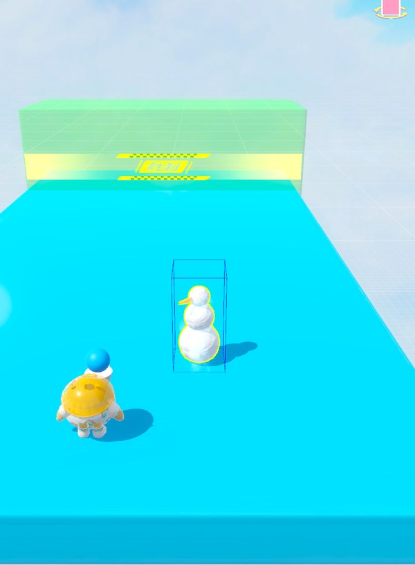

# danzai-editor

让 [Claude Code](https://docs.claude.com/en/docs/claude-code/overview) **不碰屏幕**、直接操控「蛋仔派对」PC 编辑器的 Agent Skill。

你用一句中文描述想要什么，Claude 会自己查组件编号、算摆放坐标、批量创建、改颜色和大小、截图检查效果，用完还能把测试组件清理干净。全程通过网易官方随编辑器下发的 `editor-cli` 完成，不会模拟鼠标点击，也不会抢你的鼠标。

> **非官方项目**：本仓库与网易、蛋仔派对官方没有任何关系。仓库里不包含网易的程序和文档；`editor-cli` 和官方资料由编辑器自己下载到你的电脑上。



*上图是一个完全没有上下文的 Claude 只读了本技能后，按「在出生点旁边搭一个小雪人：三个白球叠起来，下大上小，再加一个橙色的鼻子」完成的结果。它自己查到了「雪球」「冰刺」两个组件，算好叠放高度，截图确认后又自行删除了。*

---

## 目录

- [能做什么](#能做什么)
- [工作原理](#工作原理)
- [环境要求](#环境要求)
- [安装](#安装)
- [怎么用](#怎么用)
- [脚本 eggy.py](#脚本-eggypy)
- [实测踩过的坑](#实测踩过的坑)
- [安全设计](#安全设计)
- [已知限制](#已知限制)
- [编辑器升级以后](#编辑器升级以后)
- [目录结构](#目录结构)
- [许可证](#许可证)

## 能做什么

| 场景 | 例子 |
|---|---|
| 搭场景 | 「在终点前面摆一排红色的柱子」「用基础形状拼一只小猪」 |
| 改场景 | 「把所有 PIG_ 开头的组件放大 1.5 倍」「地砖换成浅蓝色」 |
| 查场景 | 「地图里现在有哪些组件，都在哪」「出生点在哪」 |
| 看效果 | 截编辑器视口或试玩画面，Claude 自己看图检查 |
| 试玩调试 | 开始和停止试玩、注入输入、读日志、提取报错 |
| 查资料 | 搜官方组件库（编号、外观、尺寸）、编辑器手册、编辑器的实时 API 签名 |
| 写玩法 Lua | 按官方技能写代码，再用 `code push` 同步进地图 |
| 导入模型 | Blender 模型减面、烘焙贴图、导出 FBX 的完整流程（最后的上传仍需手动） |

## 工作原理

```
你的一句话
   │
   ▼
Claude Code ── 读 SKILL.md（入口：调用方式、实测坑、安全边界、该读哪份官方文档）
   │
   ▼
scripts/eggy.py ── 定位 CLI、用 UTF-8 文件传 Lua、批量创建、校验编号、按组删除
   │
   ▼
~/.eggitor/cli/editor-cli.exe（官方，随编辑器下载和更新）
   │  HTTP，仅本机 127.0.0.1
   ▼
蛋仔编辑器内置的 EditorMcpProxy ── 执行 EditorAPI
```

本技能**只做入口**。具体 API 的用法以两样东西为准，它们都会随编辑器自动更新：

- 编辑器下载到 `~/.eggitor/codex/<fs|se>/` 的官方 AI 技能和规则；
- `editor-cli api get-editor <名字>` 返回的实时 API 元数据。

本技能补充的是：Claude Code 在 Windows 上的调用方式、在真实编辑器上实测出来的行为差异，以及官方没覆盖的流程。

## 环境要求

| 项目 | 要求 |
|---|---|
| 系统 | Windows 10 / 11（目前只在 Windows 上测过） |
| 蛋仔派对 | PC 版，并且**至少打开过一次编辑器**。编辑器启动时会把 `editor-cli` 下载到 `%USERPROFILE%\.eggitor\cli\` |
| Python | 3.8 及以上，只用标准库 |
| Claude Code | 任意支持 Skills 的版本 |

测试环境：editor-cli 0.20.17、eggy_api 0.0.9、帧同步（FS）地图，2026 年 11 月。

## 安装

把仓库克隆到 Claude Code 的用户级技能目录：

```powershell
git clone https://github.com/suqi8/danzai-editor "$env:USERPROFILE\.claude\skills\danzai-editor"
```

然后打开蛋仔编辑器并进入任意一张地图，在终端里检查连接：

```powershell
python "$env:USERPROFILE\.claude\skills\danzai-editor\scripts\eggy.py" status
```

看到 `editable  True` 就说明可以用了。新开一个 Claude Code 会话，技能会自动加载。

更新：

```powershell
git -C "$env:USERPROFILE\.claude\skills\danzai-editor" pull
```

## 怎么用

正常跟 Claude 说话就行，提到蛋仔或编辑器时技能会自动触发：

```text
看看我的蛋仔编辑器连上没有，地图里都有什么
在出生点右边 5 米摆一个中式大鼎，颜色改成青铜绿，截图给我看
用基础形状拼一只粉色的小猪，放在终点前面
刚才那只猪太大了，整体缩小一半
把 PIG_ 开头的组件都删掉
开始试玩，让角色走到终点，看看有没有报错
```

几个约定：

- Claude 改完场景**默认不保存**，先截图给你看，你确认后才执行 `map save`。一开始就说了「保存」的除外。
- 同一批组件会带统一的名字前缀（比如 `PIG_001_body`），方便以后整组修改或删除。

## 脚本 eggy.py

Claude 会自己调用这个脚本，你也可以直接用：

| 命令 | 作用 |
|---|---|
| `eggy.py status` | 编辑器状态。不可编辑时退出码为 2 |
| `eggy.py lua <文件\|->` | 执行编辑器 Lua。走 UTF-8 文件传给 `exec --file`，避开 shell 引号问题 |
| `eggy.py probe [函数名...]` | 探测 EditorAPI 函数在当前编辑器里是否存在 |
| `eggy.py find <名字> [--regex]` | 按名字查组件，输出 id、位置、缩放、编号 |
| `eggy.py build <spec.json> [--dry-run]` | 按配置批量创建组件：先校验编号，每批 10 个，自动设置缩放、旋转、四个染色区和名字 |
| `eggy.py delete <正则> [--yes]` | 按名字删除组件。默认只预览，加 `--yes` 才执行；会自动跳过出生点角色等非普通组件 |
| `eggy.py shot [editor\|game]` | 截图，输出 PNG 路径 |
| `eggy.py cli <参数...>` | 其他命令原样透传给 editor-cli，比如 `cli map save`、`cli play start` |

`build` 的配置示例：

```json
{
  "group": "SNOW",
  "items": [
    {"key": 102177, "pos": [-8, 2, 3.5], "scale": 1.6, "name": "bottom"},
    {"key": 100613, "pos": [-7.8, 4.75, 3.27], "scale": [0.1, 0.14, 0.1],
     "angle_deg": [0, 49, -90], "colors": ["#E67E22", null, "#E67E22"], "name": "nose"},
    {"prefab": "中式大鼎", "pos": [-14, 2, 3.5], "scale": 0.5, "color": "#3A6B5C", "name": "ding"}
  ]
}
```

- `key` 是组件编号，从官方组件库查（`eggy.py cli docs search "雪球" --docset fs-component`）。
- `prefab` 写组件名，由编辑器解析成编号。同名组件只取第一个：比如「雪球」解析出来是 1401090，而不是上面用的 102177。所以对外观有要求时用 `key`。

完整字段说明和摆放高度的计算方法见 [references/scene-building.md](references/scene-building.md)。

## 实测踩过的坑

官方文档有不少地方和实际编辑器对不上，下面这些都在真实编辑器上验证过，也已经写进技能。完整对照表见 [references/verified-api.md](references/verified-api.md)。

- **编号写错会卡住编辑器**：`create_obstacle` 遇到不存在的编号不会报错，而是返回一个无效 ID，接下来的调用会让编辑器主线程卡住 10 秒以上。所以 `build` 会先用官方组件库校验编号。
- **超时不等于没执行**：CLI 报超时或「主线程忙」时，脚本可能已经执行完了。直接重试会建出重复组件，要先查。
- **颜色只认整数** `0xRRGGBB`：传数组或 Vector3 不报错，但会被静默忽略。
- **`aabb_center` 不算缩放和旋转**，只有 `aabb_size` 可信。
- **旋转单位不统一**：写入用弧度，`get_scene_unit_data` 读回来却是角度。
- **按名字的正则查询从开头匹配**：要找包含某个词的组件，得写成 `.*词`。
- **id 1 是试玩出生的蛋仔角色**：它没有名字，但按「出生点」查会匹配到，批量删除时必须排除。
- 在帧同步地图上，官方文档里的 `editor-unit` 命令族、`get_unit_json`、`edit_unit_attrs`、`PublishService` 都**用不了**。
- 游戏目录 `bin\` 下也有一个 `editor-cli.exe`，那是 0.4 旧版；要用 `~/.eggitor/cli/` 下的新版。

## 安全设计

- 改动默认只留在编辑器内存里，不自动保存地图。
- 删除默认只预览；正则太宽（比如 `.*`）直接拒绝；自动跳过没有名字或编号为 0 的对象。
- 重开地图丢弃改动（`map reopen --force`）、强杀编辑器、发布地图、上传资源，都要你明确同意。
- 不读取、不输出 `~/.eggitor/cli/tokens.json` 里的登录凭据。
- 创建前校验组件编号，避免卡死编辑器。

## 已知限制

- 只在**帧同步（FS）**地图上测过。状态同步（SE）地图的 API 是另一套，技能会引导 Claude 去读官方 SE 文档，但没有实测。
- 编辑器视口截图的角度取决于当前镜头，可以用 `focus_unit` 对准某个组件，自由调整镜头还做不到。
- 用基础形状拼出来的是积木或雕塑风格。真要写实，需要导入自定义模型，这要求工匠等级 7 级以上，面数上限组件 1 万、生物 2 万，而且帧同步地图里上传要在编辑器界面手动完成。流程见 [references/blender-to-eggy.md](references/blender-to-eggy.md)。
- 视口、编号、API 都以编写时的编辑器版本为准，网易随时可能调整。

## 编辑器升级以后

先重新探测一遍：

```powershell
python scripts\eggy.py probe
python scripts\eggy.py cli api list-editor
python scripts\eggy.py cli doctor
```

和 [references/verified-api.md](references/verified-api.md) 对不上的地方，欢迎提 Issue 或 PR，请附上 editor-cli 版本号（`eggy.py cli --version`）和地图模式（fs 或 se）。

## 目录结构

```
danzai-editor/
├── SKILL.md                      # 技能入口，Claude 触发后最先读这个
├── scripts/
│   └── eggy.py                   # editor-cli 封装，只依赖标准库
├── references/
│   ├── verified-api.md           # 实测的接口行为与坑
│   ├── scene-building.md         # 搭建流程、坐标系、摆放计算、build 配置格式
│   ├── blender-to-eggy.md        # Blender 模型导入蛋仔
│   └── official-docs.md          # 官方技能和文档地图：什么问题读哪个文件
└── docs/
    └── demo-snowman.jpg
```

## 许可证

本项目采用 [GNU Affero General Public License v3.0](LICENSE)（AGPL-3.0-only）发布。

简单地说：你可以自由使用、修改和再分发；但如果你分发修改后的版本，或者把修改后的版本作为网络服务提供给别人使用，就必须以同样的 AGPL-3.0 许可证公开相应的完整源代码。具体以许可证原文为准。

「蛋仔派对」是网易公司的商标。本项目是社区作品，仅用于学习和提高创作效率，使用风险由使用者自行承担。
